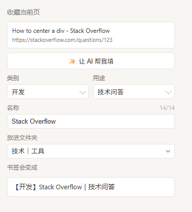

# 书签自动归类

> 收藏网页时自动起名、自动分类，让书签栏保持整齐。

一个 Edge / Chrome 扩展：按 Ctrl+D 收藏后，约 1 秒内把标题改写成 `【类别】名称｜用途`，并平铺移入对应的一级文件夹。



## 它解决什么问题

书签栏越攒越乱，原因通常不是「收藏太多」，而是**标题是网页原文**（"首页 - 某某网 - 最新资讯"）**且散落在各个子文件夹里**。想找东西时既搜不到、也翻不着。

这个扩展做两件事：

1. **改名**：`关于某某技术的介绍 - 某某博客` → `【开发】某某博客｜教程`
2. **归位**：自动放进「技术｜工具」，保持平铺，不嵌套

## 安装

1. 下载或克隆本仓库到本地任意目录
2. 地址栏输入 `edge://extensions`（Chrome 为 `chrome://extensions`）
3. 打开右上角「开发人员模式」
4. 点「加载解压缩的扩展」，选择本仓库目录
5. 点扩展栏的拼图图标 → 把「书签自动归类」固定到工具栏

首次加载时浏览器会就「读取你在所有网站上的数据」征求一次同意。这是让扩展替你去请求 AI 接口所必需的（浏览器扩展的跨域请求受同源策略限制，不授权就调不通）。**不用 AI 功能的话可以拒绝**，其它功能不受影响。

## 用法

### 日常收藏

照常按 **Ctrl+D**。收藏小框里显示的仍是原标题，这是浏览器的行为，关掉即可——书签栏里的条目已经改好了。

### 手动调整

点扩展图标打开面板：

- **类别** / **用途**：都是可搜索下拉，最近用过的排最前，也能直接手打新值
- **放进文件夹**：下拉选
- **书签会变成**：实时预览最终标题
- **✨ 让 AI 帮我填**：让 AI 读当前页，把四个字段一次填好（需先配 AI）

### 设置页

| 模块 | 作用 |
|---|---|
| 开关 | 自动归类总开关、重复链接标记、认不出的网页怎么处理 |
| 文件夹 | 增删改一级文件夹 |
| 类别一览 | 查看所有类别、搜索、新增、删除、换文件夹 |
| 自动归类规则 | 一条一条增删改「网址 → 类别」的判定规则 |
| 更多设置 | AI 配置、规则导入导出、试算、检查 |

## 分类是怎么判定的

按顺序，先命中先用：

1. **网址规则**：按域名认站，子域逐级向上找（`a.b.com → b.com`）
2. **标题关键词规则**：按标题里的词判断，顺序敏感
3. **AI 自动识别**：前两条都没认出来、且你配好了 AI 时才调用
4. **都没认出来**：标题记为 `【待整理】原名｜未分类`，放进兜底文件夹

想验证某个网址会被怎么处理，用「更多设置 → 试算一下」。

## 关于规则库

**本仓库内置的域名规则只有 6 条示例**（GitHub、Stack Overflow、YouTube、ChatGPT 等常见站点），故意做了精简。原因：原作者的规则库是从自己几千个书签里长出来的，里面必然包含「只对他有意义」的站点，原样放出来对别人是噪音。

所以推荐你自己攒规则：

- **小量**：设置页「类别一览」加类别，再到「自动归类规则」加网址规则
- **批量**：改 `tools/domain_rules.json`，然后跑
  ```bash
  python tools/gen_rules.py
  ```
  重新生成 `rules.js`。格式是 `{"域名": ["类别", "名称", "用途"]}`

规则越用越准，这是这类工具的正常形态。

## 配置 AI（可选）

在「更多设置 → AI 自动识别」填三项：服务地址、模型、密钥。任何兼容 OpenAI `/chat/completions` 的服务都行，例如：

| 服务地址 | 模型示例 |
|---|---|
| `https://api.deepseek.com/v1` | `deepseek-chat` |
| `https://api.openai.com/v1` | `gpt-4o-mini` |
| 本机网关（如有） | 见网关文档 |

填完点「测试一下」验证，别只看填没填。AI 只发送**页面标题和网址**，不发送网页内容。单次调用 3 秒超时，超时自动跳过，不影响收藏。

## 已知限制

- 只处理 `http` / `https` 页面；`edge://`、`chrome://`、`file://` 不处理
- 会**拆掉二级文件夹**：即使你手动存进子文件夹，也会被移到一级文件夹之一（设计如此，保持平铺）
- 已符合 `【xx】xx｜xx` 格式的标题不再改动，可安全重复收藏
- 扩展停用后，已改好的标题保持原样，不会回滚

## 开发

没有构建步骤，改完文件到 `edge://extensions` 点「重新加载」即可。

```
manifest.json     MV3 清单
background.js     service worker 入口（只负责按顺序 importScripts）
rules.js          规则库 + 常量 + 名称清洗（由 tools/gen_rules.py 生成，勿手改）
bookmarks.js      书签与文件夹读写原语
classify.js       判定链 + 规则补丁
router.js         启动流程、消息路由、事件监听
popup.html/js     收藏面板
options.html/js   设置页
tools/            规则生成器、规则源数据、回归测试
```

跑测试：

```bash
node tools/mock_test.js
```

用 `vm` 建独立上下文，mock 了 `chrome.bookmarks` / `chrome.storage` / `fetch`，覆盖完整启动与消息链路，共 145 项断言。

## 反馈

用着不顺手、分类判错、想要什么功能，都欢迎提 [Issue](../../issues)。提之前可以先看看有没有人提过。

如果你有自己的规则包想分享，也欢迎开 Issue 说明，说不定能做成分发模板。

## 许可

[MIT](LICENSE)
